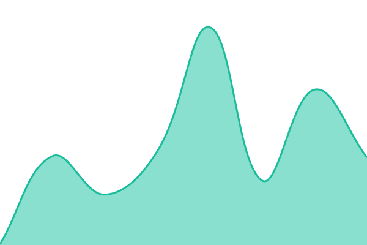

# [📈 Live Status](https://0xdhrv.github.io/uptime/): <!--live status--> **Pending setup**

  

Availability and incident history for Dhruv Suthar's websites and projects, powered by [Upptime](https://upptime.js.org).

With [Upptime](https://upptime.js.org), you can get your own unlimited and free uptime monitor and status page, powered entirely by a GitHub repository. We use [Issues](https://github.com/0xdhrv/uptime/issues) as incident reports, [Actions](https://github.com/0xdhrv/uptime/actions) as uptime monitors, and [Pages](https://0xdhrv.github.io/uptime/) for the status page.

<!--start: status pages-->
<!-- This summary is generated by Upptime (https://github.com/upptime/upptime) -->
<!-- Do not edit this manually, your changes will be overwritten -->
<!-- prettier-ignore -->
| URL | Status | History | Response Time | Uptime |
| --- | ------ | ------- | ------------- | ------ |
|  [Dhruv Portfolio](https://dhrv.pw) | 🟩 Up | [dhruv-portfolio.yml](https://github.com/0xdhrv/uptime/commits/HEAD/history/dhruv-portfolio.yml) | 

 153ms
     
 | 

<a href="https://0xdhrv.github.io/uptime/history/dhruv-portfolio">100.00%</a>
    

|  [Dhruv Resume](https://cv.dhrv.pw) | 🟩 Up | [dhruv-resume.yml](https://github.com/0xdhrv/uptime/commits/HEAD/history/dhruv-resume.yml) | 

 124ms
     
 | 

<a href="https://0xdhrv.github.io/uptime/history/dhruv-resume">100.00%</a>
    

<!--end: status pages-->

[**Visit our status website →**](https://0xdhrv.github.io/uptime/)

## Monitored sites

- [Portfolio](https://dhrv.pw)
- [Résumé](https://cv.dhrv.pw)
- [dhrv.cloud](https://dhrv.cloud)
- [Oneko](https://oneko.dhrv.pw)
- [Microkeys](https://microkeys.dhrv.pw)
- [Lilpix](https://lilpix.dhrv.pw)
- [Goto](https://goto.dhrv.pw)

The five new monitors start collecting history after Setup CI runs. Existing portfolio
and résumé slugs are unchanged, preserving their history. Week Flow is retired from
the live summary; its historical logs and graphs remain in Git.
Goto checks its public landing page for HTTP 200 and the expected page title;
this does not exercise authenticated dashboard or short-link creation behavior.

## Configuration and deployment

Edit `.upptimerc.yml` for monitors, branding, and navigation. `assets/theme.css` is
served by GitHub Pages at `/uptime/theme.css`, with a local Inter font under
`assets/fonts/`. The theme follows the system light/dark preference and uses the
neutral palette, orange accent, and narrow typography-led layout from [dhrv.pw](https://dhrv.pw).

All eight Upptime workflows are retained. Uptime CI checks endpoints on
a five-minute cron schedule; GitHub may delay scheduled runs. Setup CI runs when
`.upptimerc.yml` changes and regenerates data, README, graphs, and the status page.
Static Site CI also rebuilds when assets change. Both deployment workflows now
accept push events only on `master` and have a `master` job guard, so pushing this
feature branch or opening its draft PR does not deploy the page.

The branch filters and job guards in `setup.yml` and `site.yml` are local
customizations. Upptime's template updater regenerates these files and can
overwrite the guards. Review regenerated workflow changes and retain these guards
before using future feature branches; Upptime currently has no config option for
preserving custom branch filters. The other six workflows are unchanged and
have no push or pull-request triggers.

To activate these changes after merging into `master`:

1. Let **Setup CI** complete, then run **Uptime CI** and **Summary CI** to refresh
   the initial status and response-time data. Run **Static Site CI** if the page
   needs rebuilding after those checks.
2. Verify GitHub Pages is configured to publish from the `gh-pages` branch, root
   directory. The existing public URL is <https://0xdhrv.github.io/uptime/>; no
   custom domain or DNS change is needed.
3. Remove the `status` label from [the retired Week Flow incident #135](https://github.com/0xdhrv/uptime/issues/135)
   and close it as **not planned**. Upptime does not automatically resolve an
   incident for an endpoint removed from the configuration. Removing that label
   keeps this retirement out of both the active incidents and recovery feed;
   the issue and historical logs remain available in GitHub.
4. Check each new monitor and an individual history page, both theme modes, and
   the mobile layout after deployment.

The existing Actions runs already succeed. These public HTTP checks need no
service API keys. Keep the repository's working token configuration; no new
credentials, account permissions, or notification integrations are required for
this change. Optional notifications can be configured separately using the
[Upptime notification docs](https://upptime.js.org/docs/notifications/).

## Font

Inter is served locally under its [SIL Open Font License](assets/fonts/LICENSE.txt).

## 📄 License

- Powered by: [Upptime](https://github.com/upptime/upptime)
- Code: [MIT](./LICENSE) © [Anand Chowdhary](https://anandchowdhary.com), supported by [Pabio](https://pabio.com)
- Data in the `./history` directory: [Open Database License](https://opendatacommons.org/licenses/odbl/1-0/)
